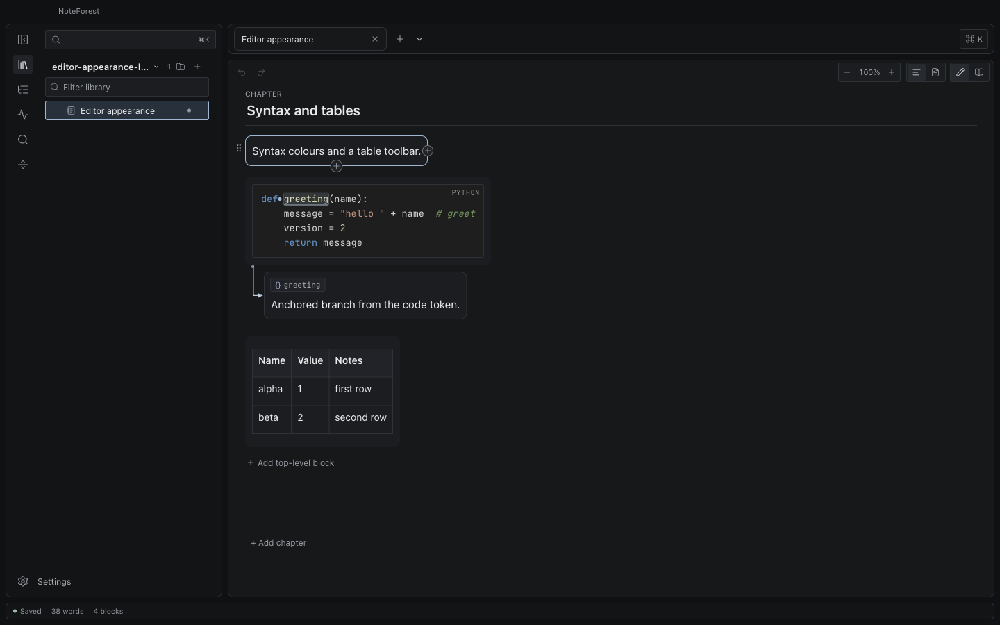
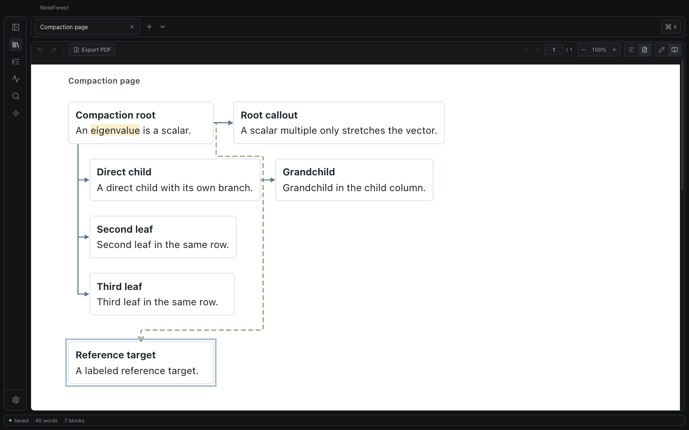
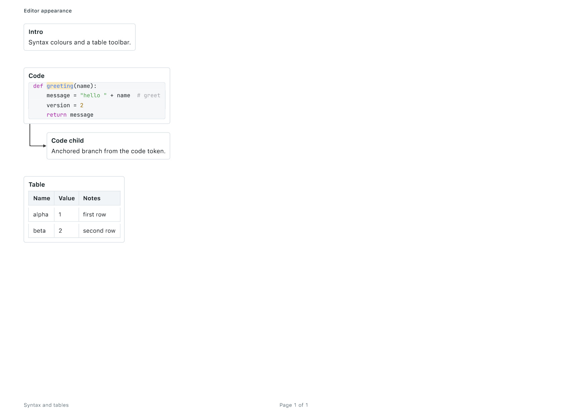

# NoteForest

A Mac-first spatial note-taking app for studying. Notes are built from content blocks connected by explicit
arrows; a branch can start from a whole block or from a word, formula term, code token, or image region. The
same document reads as **Continuous** (the writing canvas) or **Page** (exact A4 pages), each with **Edit** and
**Read** modes. PDF export produces the Page layout with real text, meant to be annotated by hand outside the
app.

MIT licensed (see [LICENSE](LICENSE)).

## Status

**Released 0.1.0 (18 November 2026).** v1 is feature-complete; `docs/plan.md` has the milestone history and the
v2 backlog. The app is macOS-only and Apple-silicon-first.

## Screenshots

Continuous, the writing canvas — a branch anchored to a code token:



Page, the same content as exact A4 pages with arrows and callouts:



The exported PDF keeps the page layout, with real text:



## Install (macOS)

There is no App Store build and no notarized distribution. The app is built locally and is **not signed with a Developer ID**; the build carries an ad-hoc signature so the bundle is internally consistent.
`npm run dist` writes `dist/NoteForest-0.1.0-arm64.dmg` and the `.app` next to it; `npm run install:local`
copies it to `/Applications`.

```bash
git clone https://github.com/luk3luca/noteforest.git
cd noteforest
npm install
npm run dist          # electron-builder → dist/NoteForest-0.1.0-arm64.dmg + NoteForest.app
npm run install:local # copies the built app to /Applications
```

You can also open the dmg and drag **NoteForest** into Applications. An app built on your own Mac runs
without Gatekeeper warnings; a downloaded copy would ask for **right-click → Open** the first time.

## Updating

**There is no auto-update.** The installed app is a copy built from a tag; pushes to `main` do not change it.
You update by pulling, rebuilding and replacing the app — the repository is never re-cloned. The one-command
check is `update:local`: it fetches the tags, says whether a newer release exists, and with `--yes` pulls,
rebuilds and installs.

```bash
cd noteforest
npm run update:local            # check only
npm run update:local -- --yes   # pull, dist, install (quit NoteForest first)

# or by hand:
git pull --tags
npm install                     # only when dependencies changed
npm run dist
npm run install:local
```

- A release is a **tag** (`v0.1.0`, `v0.2.0`, …). `main` can move many times without a release.
- A true background updater needs a signed app (`electron-updater` + Squirrel.Mac) and a published feed.
  That is not enabled; if it ever is, it will be a deliberate change, not an automatic one.
- A lightweight "is there a new tag?" check is a script you run, not a daemon: `git fetch --tags` and read the
  newest tag, or watch the repository's Releases page.

Your notes and settings live **outside** the app, so replacing it never touches content:

- notes: the library folders you chose;
- settings and recovery data: `~/Library/Application Support/NoteForest`.

Quit the app before replacing it. If the same note is open in two copies, the live lock reports it; it is
never silently overwritten.

## Development

npm workspaces (`apps/desktop`, `packages/core`, `packages/layout`, `packages/pdf`), Node 22+.

```bash
npm install
npm run dev            # electron-vite dev shell (hot reload)
npm run typecheck      # strict TypeScript across the workspaces
npm test               # unit / geometry / fixture tests
npm run e2e            # critical Playwright-driven Electron suite
npm run test:ui        # build + view/accessibility UI suite
npm run test:recovery  # corrupt/missing/newer recovery + backup restore
npm run verify:fast    # typecheck + unit + critical e2e
npm run verify         # verify:fast + recovery + view UI (the integration gate)
npm run test:perf      # 300 / 1,000-block performance report (on demand)
npm run test:visual    # screenshots for product-owner review (on demand)
```

`npm run dev` and `npm start` launch the Electron shell. Test artifacts default to `artifacts/`; set
`NOTEFOREST_ARTIFACTS` to redirect them.

## Undo and redo

Undo/redo is one user command with two internal stacks. The last operation chooses the preferred stack: text
after typing or a text undo/redo, structural after a structural command. If the preferred stack is empty the
command falls back once to the other one; it never loops and never performs two steps for one keypress.
`⌘Z`, `⇧⌘Z`, the Edit menu, the palette and the settings action all route through `lib/history-routing.ts`.

## Docs

- `docs/plan.md` — milestones, decisions, known issues, the v2 input.
- `docs/spec.md`, `docs/ux.md`, `docs/ux-shell.md` — product, data model and interaction.
- `docs/adr/` — stack, PDF pipeline, layouts/modes, page settings, copy identity.
- `docs/reviews/` — Sentinel reviews, including the v1-candidate review.
- `docs/design/` — page/Continuous tokens, themes, find and highlighter, shortcut catalogue.
